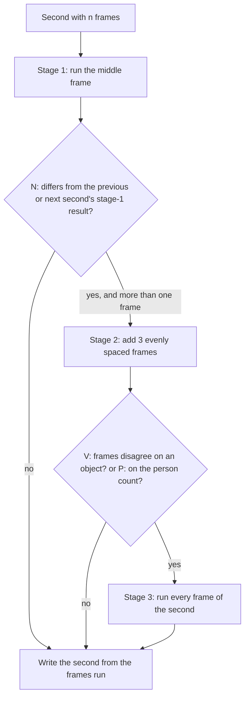
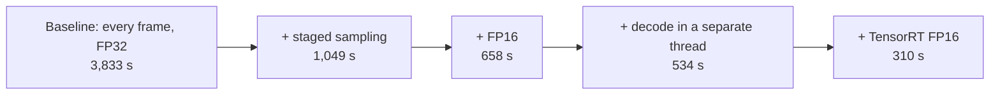
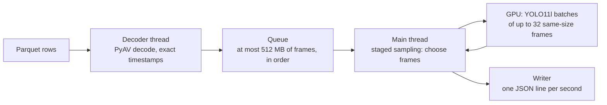
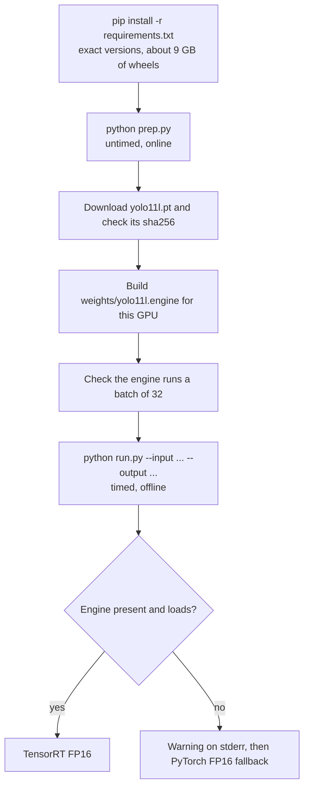

# Approach

How we built the video indexer, found where the time went, and made it faster step by step, checking correctness after every change. `DECISIONS.md` has the full detail: each design choice is labelled there as D-xxx, and each timed run as S-x.

## 1. The task in one paragraph

The input is a folder of Parquet files. Each row holds one MP4 video.

For every second of every video, `run.py` writes one JSON line. The line says which of five objects (person, car, dog, laptop, cell phone) are present, and how many people are visible.

The brief fixes the rules:

- **Model:** YOLO11l at image size 640, with confidence 0.4 and class-aware NMS at IoU 0.7.
- **Presence:** an object is present in a second if it's detected in at least half of that second's frames.
- **People count:** the floor of the median per-frame person count.

The brief grades the output against a reference that runs the model on every frame:

| Metric | Required |
|---|---|
| Object F1 | ≥ 0.95 |
| People count exact | ≥ 85% of seconds |
| People count within ±1 | ≥ 95% of seconds |

The timed run happens offline on an RTX 4090, and speed only counts if the results pass.

Terms used below:

- **Inference:** running the neural network on an image to get detections.
- **FP32 / FP16:** 32-bit and 16-bit floating-point numbers. FP16 halves the data size, and GPUs with tensor cores compute with it much faster.
- **Batch:** several images sent through the model in one call. That keeps the GPU busy, compared with one image at a time.
- **Letterbox:** resizing an image to the model's input size while keeping its aspect ratio, padding the rest.
- **NMS (non-maximum suppression):** removes overlapping duplicate boxes for the same object.

## 2. Ground rules we set before optimising

We set three rules before changing anything for speed.

1. **Build the reference first (D-003).** `validation/build_reference.py` runs the model on every frame of a fixed set of videos and stores every frame's detections. `reference_aggregate.py` turns them into the per-second answer. This code is deliberately separate from `run.py`, so a bug isn't shared between the pipeline and the reference that checks it.
2. **Decide by measurement (D-002).** Every speed idea is timed on real data, on the same GPU, before it's adopted.
3. **Check correctness at five levels (D-004).** The table lists the five layers.

| Layer | Question |
|---|---|
| 1. Data and decoding | Did we read every video and decode the right frames, with the right timestamps? |
| 2. Model equivalence | Does the model see the same pixels and give the same detections? |
| 3. Aggregation | Are votes, medians and second boundaries computed exactly? |
| 4. Completeness and score | Is every expected line present, and does the score pass? |
| 5. Robustness | Does it hold on damaged videos, unseen data and large inputs? |

**Test data** (D-006, D-012, D-018):

| Set | Videos | Seconds | Use |
|---|---|---|---|
| Dev: sequential | 66 (files `train-00000`, `train-00001`) | 18,806 | timing and accuracy |
| Dev: diverse | 35 from 10 files outside the graded 50, picked to cover rare resolutions, frame rates and shapes | 8,582 | accuracy |
| Holdout | 48, a plain random sample from 8 other files | 14,341 | final confirmation only; nothing is tuned on it |
| Fixtures | 17 synthetic videos | — | rotation, variable frame rate, gaps, truncated and corrupt files, empty bytes, audio-only and other edge cases |

The real data contains none of the damaged or unusual cases the brief warns about. That is why the synthetic fixtures exist (D-013).

**Acceptance rules for every optimisation (D-020):**

- **Correctness margins**, on dev and on the holdout: F1 ≥ 0.99, people exact ≥ 0.98, within ±1 ≥ 0.995. These are much stricter than the brief's thresholds.
- **Speed:** at least 5% less end-to-end wall time, seen in two comparable runs.
- **Other checks:** all fixtures and unit tests pass, memory stays bounded, and the run works offline.

## 3. The first working pipeline (baseline)

The baseline (D-015) runs the model on every frame:

1. Read each Parquet row.
2. Decode the MP4 with **PyAV**, a Python binding to FFmpeg.
3. Convert each frame to a BGR array and rotate it if the video has a rotation tag.
4. Batch up to 32 frames from the same video and run YOLO11l in FP32.
5. Aggregate each second and write it.

The details that matter for correctness:

- **Timestamps are exact fractions.** A frame's time is `(pts − first_pts) × time_base`, computed with Python's `Fraction`, and its second is `floor(t)`. Floats could put a frame that sits exactly on a second boundary into the wrong second.
- **IoU must be passed explicitly.** In Ultralytics 8.4.215 the default predict IoU is 0.5, not the 0.7 the brief calls "the default" (D-014). Both `run.py` and the reference pass `iou=0.7`.
- **Batches never mix videos.** All frames in a batch then have the same shape, so Ultralytics uses the same letterbox as single-frame inference. We checked this: batched and single-frame results gave the same classes, with confidence differences under 0.0005.
- **Damaged videos don't stop the run.** A video that fails keeps the seconds already written and gets one error line.

**Result** (S-1, GPU 0, the 66 sequential videos):
- **Accuracy:** identical to the reference, with every metric at 1.0000.
- **Speed:** **3,833 s** (63.9 min), 137 frames/s, using one CPU core and about 90% of the GPU.
- **Estimate for the full 50 files:** about 25.5 h. This is an estimate, not a measurement.

Decoding turned out to be cheap: about 67 CPU-seconds for all 767k dev frames, without converting them to arrays. **Inference was the cost.** That pointed at the first lever: run the model on fewer frames.

## 4. Step 1: frame sampling, the largest gain

Most consecutive frames in a second show the same thing. If we can tell which seconds are "easy", we can run the model on one frame there and on more frames only where the answer is in doubt.

### How we chose a strategy without a GPU

The reference stores every frame's detections, so any sampling rule's output can be computed exactly from them. `validation/simulate_sampling.py` does this: pick frames by the rule, aggregate them with the brief's rules, and score. About 50 strategies were scored in about 30 seconds, with no GPU (D-016). The simulator's every-frame mode reproduces the reference exactly on all 27,388 seconds, which shows the simulator itself is correct.

A selection from D-016's simulated results (dev set, frames run as a share of all frames):

| Strategy | Frames run | F1 | People exact | Within ±1 |
|---|---|---|---|---|
| every frame | 100% | 1.000 | 1.000 | 1.000 |
| 1 frame per second | 3.6% | 0.932 (fails) | 0.920 | 0.990 |
| 2 frames per second | 7.1% | 0.893 (fails) | 0.915 | 0.993 |
| 3 frames per second | 10.7% | 0.964 | 0.952 | 0.998 |
| staged 1 > 3 > 9 > all, rules V and N | 15.8% | 0.994 | 0.966 | 0.998 |
| **staged 1 > 3 > all, rules V, P and N (chosen)** | **25.0%** | **0.995** | **0.994** | **1.000** |

What the simulations showed:

- **Even frame counts are worse than odd ones.** With 2 frames, a 1-of-2 split is a tie, and the brief's "at least half" rule counts a tie as present. So 2 frames per second scores *lower* than 1.
- **Object F1 is the hardest metric.** The rarest object, cell phone (1.8% of seconds), limits it. People exact has more slack.
- **Comparing neighbours makes a 1-frame first stage work.** If a second's one-frame answer differs from the next or previous second's, something is changing there, so look closer.

### The chosen rule: `staged-1>3>all-VPN` (D-017)

- The positions nest: the middle frame is one of the three stage-2 frames, so no frame is ever run twice.
- The second's answer uses **every frame that was run** for it, with the brief's half-vote and median rules.
- Rule N needs one second of look-ahead, so `run.py` buffers decoded frames. They're kept compact, in their decoded form, and only frames sent to the model are converted to BGR.

### Results

The real `run.py` output equalled the simulator's prediction on **all 27,388 dev seconds**, and the number of frames run matched for every video.

| Measure | Dev | Holdout |
|---|---|---|
| F1 | 0.9947 | 0.9947 |
| People exact | 0.9940 | 0.9950 |
| Within ±1 | 0.9999 | 0.9999 |

- **Speed:** **1,049 s**, against 3,833 s for the baseline: **3.65× faster** (S-3).
- **Frames run:** 24.0%. The speed-up is smaller than 1/0.24 ≈ 4.2× because every frame is still decoded, batches are smaller, and there is more Python work per second, all on one CPU core.

This result is approximate by design: the output no longer equals the every-frame reference exactly, but it passes the brief's thresholds and our stricter margins with room to spare. The sampling rule was then frozen; later steps only changed how fast the same rule runs.

### Memory safety (D-019)

Buffering seconds for the look-ahead raised a memory question. A check found and fixed four problems:

- **A single huge second could be buffered whole.** Now a second over 512 MB is run frame by frame as it's decoded, still using every frame. This never happens on real data.
- **The out-of-memory retry kept the failed batch alive.** It ran inside the `except` block. It now retries outside it, after releasing memory, so the failed batch can be freed.
- **Ultralytics kept the last batch's images between calls.** These are now dropped after every call.
- **After an out-of-memory error, batches went straight back to full size.** The batch size is now halved and remembered per image shape.

Tests with real 4K video confirmed that memory stays bounded and that out-of-memory recovery works.

## 5. Step 0: profiling, to find where the time goes

With sampling fixed, we profiled every stage (D-021; 10-video profiling set, FP32):

| Stage | Share of wall time |
|---|---|
| **Model forward pass (FP32)** | **75.6%** |
| Decode (PyAV) | 9.4% |
| Convert YUV → BGR (frames that are run) | 7.8% |
| Preprocess (letterbox, copy to GPU) | 3.1% |
| Postprocess (NMS, results) | 2.7% |
| Sampling, aggregation, writing | 1.3% |

The conclusion: the forward pass dominates, so precision and the inference engine are the main levers. The CPU stages, about 24% of the time, run one after another with the GPU work, so overlapping them was the next lever.

## 6. The optimisation steps

Each step was screened on the 10-video profiling set. If it was promising, it was timed in full on the 66-video set, interleaved with a control run (control, candidate, control, candidate), and then put through all the correctness checks.

All times are measured, on the same 66 videos (5.21 h of video) and the same GPU 0 (a Quadro RTX 6000).

### 6.1 FP16 inference (D-022): promoted

- **Change:** run the PyTorch model in half precision (`quantize=16`).
- **Why it helps:** the forward pass was 76% of the time. FP16 moves half the data and uses the GPU's tensor cores. The forward pass got 1.84× faster.
- **Correctness:** frame by frame, the detected object set changed on 0.070% of dev frames, almost all of them detections with confidence between 0.40 and 0.45, right at the threshold.

  | | Dev | Holdout |
  |---|---|---|
  | F1 | 0.9938 | 0.9947 |
  | People exact | 0.9928 | 0.9939 |
  | Within ±1 | 0.9999 | 0.9999 |

- **A subtlety:** FP16 results depend slightly on which frames share a batch. Confidences moved by up to 0.007, against under 0.0005 in FP32. That is why the real run differed slightly from the simulation in 4 of the 101 dev videos. Each of those videos had exactly one frame whose detections changed with the batching, and each one was traced.
- **Speed:** **658 s**, from 1,049 s (**−37%**, S-6).

### 6.2 Decode in a separate thread (D-023): promoted

- **Change:** a decoder thread reads and decodes videos and passes the frames, in order, through a queue limited to 512 MB. The main thread runs the same sampling, inference and writing code as before.
- **Why it helps:** after FP16, the CPU stages were about 37% of the time, and they ran while the GPU waited. PyAV releases Python's global interpreter lock (GIL) while decoding, so decoding really runs in parallel with GPU work.

- **Stricter rules for this step:** concurrency bugs can drop or reorder frames silently. So this step had to produce **byte-identical output and exactly the same frames sent to the model** as the FP16 version, and it did, on every set.
- **Testing:** unit tests run it against the serial version with tiny queues that force constant waiting, and with decoder failures. A crash in the decoder thread ends the run instead of hanging it.
- **Fallback:** the serial loop is kept as `--pipeline serial`.
- **Speed:** **534 s**, from 658 s (**−19%**, S-7).

### 6.3 PyAV decoder threading (D-024): rejected

- **Idea:** let FFmpeg use several threads per video. Measured alone, decoding got about 4.9× faster.
- **Result:** no end-to-end gain. All configurations were within ±0.6% of the control.
- **Why:** after step 6.2, decoding was already hidden in its own thread, and it had about 4× more throughput than the pipeline used. The limit was the main thread, so faster decoding only filled the queue sooner. The option was removed to keep `run.py` simple.

### 6.4 TensorRT FP16 (D-025): promoted

- **Change:** run YOLO11l as a **TensorRT engine**. TensorRT is NVIDIA's inference compiler: it turns the network into an engine optimised for one specific GPU model. The engine is built with Ultralytics' export (FP16, dynamic batch 1–32, image size 640). Letterbox and NMS stay exactly as in PyTorch.
- **Why it helps:** even in FP16 PyTorch, the forward pass was still the largest stage.
- **Correctness:** the object set changed on 0.123% of dev frames, about twice FP16's rate, again at the threshold.

  | | Dev | Holdout |
  |---|---|---|
  | F1 | 0.9928 | 0.9933 |
  | People exact | 0.9922 | 0.9934 |
  | Within ±1 | 0.9998 | 0.9999 |

- **No batch dependence:** unlike PyTorch FP16, TensorRT gives the same result whether a frame runs alone or in a batch. So the simulation predicted the real run exactly, with 0 differing seconds on both sets.
- **Speed:** **310 s**, from 534 s (**−42%**, S-10). The two runs were byte-identical.
- **Memory:** TensorRT reserves 4.6 GB of GPU memory up front, and peak RAM fell from 7.9 to 6.2 GB.

### 6.5 Deferred and not applicable (D-026)

- **#5 batch-size tuning:** deferred. In FP32, going from batch 32 to 64 gained under 1%.
- **#6 less preprocessing and copying:** deferred.
- **#7 cuDNN benchmark mode and `torch.compile`:** don't apply to the TensorRT path.

Both deferred steps were left until the full results were secured, because each would have required re-running the whole validation.

## 7. Summary of measured speed and accuracy

| Version | Wall time (66 videos) | Speed-up vs baseline | Dev F1 / exact / ±1 | Holdout F1 / exact / ±1 |
|---|---|---|---|---|
| Baseline, every frame, FP32 (S-1) | 3,833 s | 1.0× | 1.0000 / 1.0000 / 1.0000 | — |
| + staged sampling (S-3) | 1,049 s | 3.65× | 0.9947 / 0.9940 / 0.9999 | 0.9947 / 0.9950 / 0.9999 |
| + FP16 (S-6) | 658 s | 5.8× | 0.9938 / 0.9928 / 0.9999 | 0.9947 / 0.9939 / 0.9999 |
| + threaded decoding (S-7) | 534 s | 7.2× | same as FP16 (byte-identical output) | same as FP16 |
| **+ TensorRT FP16 (S-10, final)** | **310 s** | **12.4×** | **0.9928 / 0.9922 / 0.9998** | **0.9933 / 0.9934 / 0.9999** |

Every row is a measurement except the baseline's holdout cell, which wasn't measured.

All scores are measured against the every-frame FP32 reference. Each optimisation gave up a little accuracy for speed, and every version stays well above the brief's thresholds (0.95 / 0.85 / 0.95) and our own margins (0.99 / 0.98 / 0.995).

**Full run (S-11, measured):**
- **Content:** all 50 files: 1,650 videos, 461,757 seconds, about 128 h of video.
- **Time:** **1 h 57 min 38 s** on one Quadro RTX 6000. The baseline estimate was about 25.5 h.
- **Problems:** 0 errors.
- **Completeness:** an independent checker (`validation/check_full_results.py`) works out the expected seconds from the videos' packet timestamps without using `run.py`. Every video and second was present.

**Estimate for the graders' 13 h test set:** about 12 minutes on the RTX 6000 at the S-11 rate. The RTX 4090 is a different GPU (Ada, not Turing), so its time has to be measured, not assumed.

## 8. Deployment on the grading machine

- **The engine is built on the grading machine.** A TensorRT engine only runs on the GPU model and TensorRT version it was built with, so it can't be shipped prebuilt. `prep.py` builds it during the untimed preparation step. That took about 6 minutes here, after a 4 GB TensorRT download during `pip install`.
- **Fallback:** if the engine is missing or doesn't load, `run.py` prints a warning and runs PyTorch FP16, which is slower but validated (section 6.1).
- **Offline:** `run.py` sets `YOLO_OFFLINE=1` and turns off Ultralytics' auto-install. Under `validation/offline_guard.py`, which blocks Python networking, the run made 0 network attempts.
- **Clean-environment test (D-027):**
  - Setup: a fresh venv and a fresh copy of the repository, then `prep.py`, then offline runs on dev and the holdout.
  - Scores with the newly built engine: dev F1 0.9918, people exact 0.9920, within ±1 0.9998; holdout 0.9935 / 0.9933 / 0.9999. All 17 fixtures and 23 unit tests passed.
- **Engines vary between builds:** TensorRT can choose different kernels each time it builds, so two builds aren't bit-identical. The new engine changed 0.12% of seconds. With the original engine, the clean environment reproduced S-10 and `results.jsonl.gz` byte for byte, so the difference comes only from the rebuild. A run on the grading machine will differ from `results.jsonl.gz` by about this much.

## 9. What we would look at next

- **The main thread is now the limit:** converting frames to BGR, plus pre- and post-processing, still run between GPU batches. Experiment #6 (less preprocessing and copying) targets this.
- **Batch size (#5):** a small expected gain.
- **A faster sampling rule** (`staged-1>3>9>all-VN`, 15.8% of frames) is documented in D-016 but not implemented. It gives up people-count accuracy (exact about 0.966) for speed, and would only be worth it if speed ever became critical.
